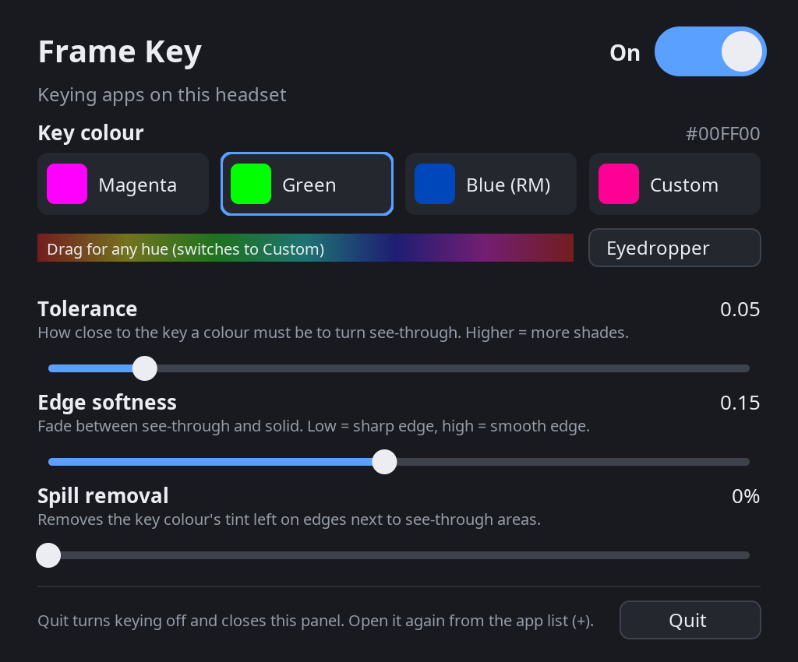

# frame-key

See-through spots in apps running on a **Steam Frame**. Whatever an app draws
in a key colour shows the Frame's own passthrough camera instead: the green
screen behind a 360 or 3D video becomes your room. Nothing is needed in the
app.

**PC VR streams are not touched.** Since SteamOS 0.5.9, SteamVR keys Steam
Link streams itself (on the PC: SteamVR settings > Camera, mode **Key
Content**), so use that for Reality Mixer boxes and anything else drawn on the
PC. Frame Key releases before 0.7 keyed the stream and installed an OpenXR
layer on the PC; this one removes both and leaves PC VR alone.

Native apps have no such setting, so this is a chroma key in the Frame's
compositor: it turns the key colour into transparency. See
[docs/how-it-works.md](docs/how-it-works.md).

## Before you install

The PC installs it on the headset over SSH, so the Frame needs, once:

1. **Developer Mode** on: Steam Settings > System > Enable Developer Mode.
2. A **password** for the `steamos` user: in the left menu, scroll down to
   the **Developer** section, then near the bottom of that page click
   **Set User Password**.
3. The Frame and the PC on the **same network**, and the Frame's IP address
   (its Wi-Fi settings, or your router's device list).

The PC needs Windows 10 or 11 with the **OpenSSH Client** (built in; if it's
missing: Settings > System > Optional features > OpenSSH Client). Nothing is
installed on the PC.

## Install

Download the zip from the [latest release](../../releases), **extract it** to
a folder, and double-click **Install.cmd**. It:

1. removes the PC side of an earlier Frame Key release, if there is one (the
   OpenXR layer, the Frame Key window and its Start menu entry);
2. asks for the Frame's address (on updates it finds the headset by itself),
   asks for the Frame's password the first time only, then installs Frame Key
   on the headset. It makes its own SSH key for this
   (`%USERPROFILE%\.ssh\frame-key_ed25519`) so later runs don't ask again.
   SteamVR on the Frame restarts at the end, which closes any running VR app.

To update, extract the new release and run Install.cmd again; your settings
are kept. **Uninstall.cmd** removes it from the headset.

By hand: `pc\install-headset.ps1` (takes `-Uninstall` and
`-Target steamos@<address>`), run with
`powershell -ExecutionPolicy Bypass -File ...`. Or copy the `headset` folder
to the Frame and run `sh install-headset.sh` there.

If something goes wrong, the installer stops with what to check. A SteamVR
update can change the compositor shaders the keyer patches; the installer
checks first and refuses rather than half-installing.

## Use

In the headset: **SteamVR dashboard > Frame Key**.

- **On/Off**: keying on or off. While it's on, SteamVR's "camera at room
  edge" passthrough doesn't show, and anything in a native game close to the
  key colour turns see-through too, so turn it off when you don't need it.
- **Key colour**: magenta, green, blue, any hue, or **Eyedropper**: look at a
  colour; after a 3 s countdown the colour under the dot becomes the key.
- **Tolerance**: how close to the key a colour must be to turn fully
  see-through. Higher catches more shades (and more colours that are merely
  similar).
- **Edge softness**: the fade just past the tolerance, where colours are
  partly see-through. Low gives a sharp edge, high a smooth (eventually
  ghostly) one. Tolerance moves the edge; softness blurs it.
- **Spill removal**: removes the key colour's tint left on edges next to
  see-through areas.
- The sliders and colour apply live while you drag.
- **Quit**: turns keying off and closes the panel. It starts again with
  SteamVR, or from the Frame's app list (**+ > Frame Key**), which also opens
  the panel when it's already running.

## Green-screen video

Set the panel to **Green** (or use the Eyedropper on the video's background)
and the background becomes your room.

The key ignores brightness: every shade of the key's colour counts, so darker
green screens and shadows on them key too, while greys, white and black stay
solid. **Green** suits bright computer-made green; for a filmed green screen
(duller and unevenly lit) use the **Eyedropper** on it. Things in the video
that are the same colour as the screen (plants in front of a green screen)
turn see-through as well. A black background can't be keyed.

The compositor draws a native app in two pieces, the whole view and a sharp
circle where you look (eye-tracked foveation), and both are keyed. The app's
own transparency is kept, so apps that already show passthrough still do.

## PC VR

Use SteamVR's own chroma key (SteamOS 0.5.9 on the Frame, a matching SteamVR
on the PC): SteamVR settings on the PC > Camera, mode **Key Content**, and
paint what should be see-through in the colour chosen there. Frame Key's
switch doesn't affect a PC stream's picture, but while it is on, SteamVR's
"camera at room edge" passthrough is off during streams as well.

With Reality Mixer on SteamVR 2.19 or later, also install
[realitymixer-foveation-fix](https://github.com/nick-yoderia/realitymixer-foveation-fix),
or its solid-colour boxes fade out away from where you look.

## What's where

| | |
|---|---|
| `headset/key_layer.cpp` | Vulkan layer, loads only into the Frame's `vrcompositor` and swaps in the keyed shaders for native apps |
| `headset/gen_key.py` | patches SteamVR's compositor shaders (SPIR-V) to key a colour |
| `headset/panel.cpp` | the Frame Key dashboard panel |
| `headset/keyer.sh` | `chroma` / `off` / `status`, used by the panel |
| `headset/xrkeytest.cpp` | test tool: native Frame app, key colour with a grey square |
| `pc/install-headset.ps1` | installs the headset side from a Windows PC over SSH |
| `pc/remove-pc-side.ps1` | removes what releases before 0.7 installed on the PC |
| `tools/make-release.sh` | builds on a Frame and zips a release |

## Building

The release zip has everything prebuilt. To build it yourself, on a Frame in
Developer Mode with its own compilers: SteamOS ships without the headers, so
put the [OpenVR SDK](https://github.com/ValveSoftware/openvr) in
`~/sdk/openvr` and
[Vulkan-Headers](https://github.com/KhronosGroup/Vulkan-Headers) in
`~/sdk/Vulkan-Headers`, then `sh headset/keyer.sh build`.

A release: in Git Bash on a PC, `FRAME_HOST=<ssh host> sh tools/make-release.sh v1.0.0`
builds on the Frame and writes `dist/frame-key-<version>.zip`.

## Limits

- Anything near the key colour in a native app also turns into passthrough.
- Tied to SteamVR's compositor shaders: knows those of SteamOS 0.5.6 to
  0.5.9. If a later SteamVR update changes them, keying stays off (the panel
  shows "last change failed") instead of drawing a broken picture, and the
  installer refuses.
- Unofficial and unsupported by Valve. Nothing under `/opt` is modified; the
  shaders are swapped in memory.

## Credits

Frame Key builds on [steam-frame-chroma-key](https://github.com/spyjacob/steam-frame-chroma-key) by spyjacob (MIT
license), first posted on
[OpenVR issue #1926](https://github.com/ValveSoftware/openvr/issues/1926).
The dashboard panel's design (colour presets, hue bar, sliders) and parts of
its code come from there, as does the approach of patching the compositor's
shaders from a Vulkan layer. Its copyright notice is in
[LICENSE](LICENSE).

MIT license.
