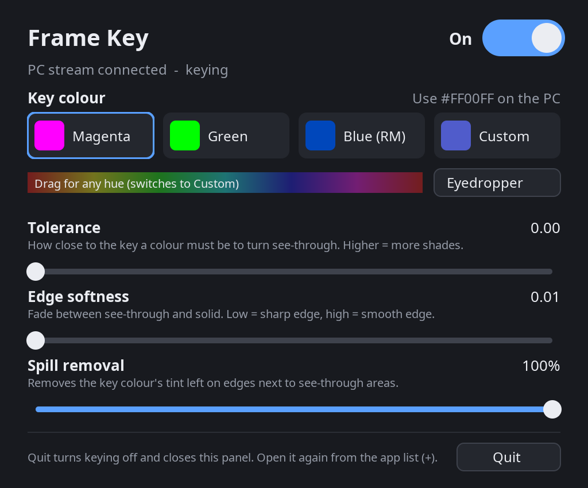
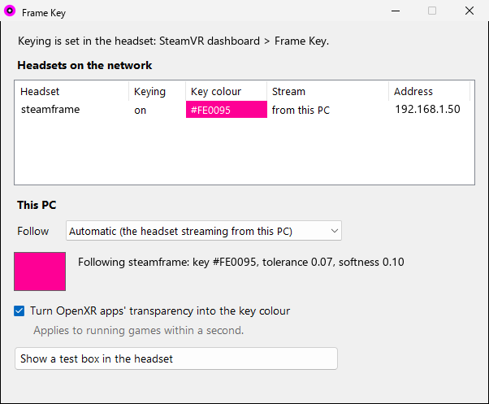

# frame-key

See-through spots in PC VR games streamed to a **Steam Frame** over Steam Link,
and in native apps on the Frame itself. Whatever is drawn in a key colour
(magenta by default) shows the Frame's own passthrough camera instead: a
keyboard on your desk, a wheel and dash in a cockpit, the green screen behind
a 360 video. It works with Reality Mixer's "solid color" boxes (on SteamVR 2.19 and
later, also install [realitymixer-foveation-fix](https://github.com/nick-yoderia/realitymixer-foveation-fix), or the boxes fade out
away from where you look), and OpenXR apps on the PC that ask for
transparency (`ALPHA_BLEND`) work too.

SteamVR has no passthrough for PC streams, and the Steam Link video has no
alpha channel, so this is a chroma key: the Frame's compositor turns the key
colour back into transparency. See [docs/how-it-works.md](docs/how-it-works.md).

## Before you install

The PC installs the headset side over SSH, so the Frame needs, once:

1. **Developer Mode** on: Steam Settings > System > Enable Developer Mode.
2. A **password** for the `steamos` user: in the left menu, scroll down to
   the **Developer** section, then near the bottom of that page click
   **Set User Password**.
3. The Frame and the PC on the **same network**, and the Frame's IP address
   (its Wi-Fi settings, or your router's device list).

The PC needs Windows 10 or 11 with the **OpenSSH Client** (built in; if it's
missing: Settings > System > Optional features > OpenSSH Client) and SteamVR.

## Install

Download the zip from the [latest release](../../releases), **extract it** to
a folder, and double-click **Install.cmd**. It:

1. installs the PC side for your Windows user (no admin rights), with a small
   **Frame Key** window in the Start menu;
2. asks for the Frame's address (on updates it finds the headset by itself),
   asks for the Frame's password the first time only, then installs the
   headset side. It makes its own SSH key for this
   (`%USERPROFILE%\.ssh\frame-key_ed25519`) so later runs don't ask again.
   SteamVR on the Frame restarts at the end, which closes any running VR app.

To update, extract the new release and run Install.cmd again; your settings
are kept. After installing, nothing needs SSH: the PC finds the headset on
your network. **Uninstall.cmd** removes both sides.

One side only: `pc\install-pc.ps1` or `pc\install-headset.ps1` (each takes
`-Uninstall`; the headset one also takes `-Target steamos@<address>`), run
with `powershell -ExecutionPolicy Bypass -File ...`.

If something goes wrong, the installer stops with what to check. A SteamVR
update can change the compositor shader the keyer patches; the headset
installer checks first and refuses rather than half-installing.

## Use

In the headset: **SteamVR dashboard > Frame Key**.

- **On/Off**: keying on or off, for PC streams and native apps alike. While
  it's on, SteamVR's "camera at room edge" passthrough doesn't show, and
  anything in a native game close to the key colour turns see-through too,
  so turn it off when you don't need it.
- **Key colour**: magenta, green, Reality Mixer's default blue, any hue, or
  **Eyedropper**: look at a colour; after a 3 s countdown the colour under
  the dot becomes the key.
- **Tolerance**: how close to the key a colour must be to turn fully
  see-through. Higher catches more shades (and more game colours that are
  merely similar).
- **Edge softness**: the fade just past the tolerance, where colours are
  partly see-through. Low gives a sharp edge, high a smooth (eventually
  ghostly) one. Tolerance moves the edge; softness blurs it.
- **Spill removal**: removes the key colour's tint left on edges next to
  see-through areas.
- The sliders and colour apply live while you drag.
- **Quit**: turns keying off and closes the panel. It starts again with
  SteamVR, or from the Frame's app list (**+ > Frame Key**), which also opens
  the panel when it's already running.

The headset is the only place keying is set. The PC follows it on its own:
every couple of seconds the PC layer asks the network (UDP broadcast, port
47911) and each headset's panel answers with its key settings and whether it
is streaming from that PC. With several headsets on one network, each PC
follows the one streaming from it.

**Start menu > Frame Key** shows the headsets on the network and which
one this PC follows (or pin one), switches the PC layer on or off, and shows a
test box in the key colour. It only runs while it's open.

Paint whatever should be see-through in the key colour:

- **Reality Mixer**: see below.
- **OpenXR apps** that ask for `ALPHA_BLEND` work through the PC layer
  (D3D11 apps so far), in the key colour of the headset they follow.
- `keybox.exe [front|hand] [RRGGBB]` (in that folder) shows a test box.

## Native apps and green-screen video

The same key also applies to apps running on the Frame itself, for example a
360 or 3D video with a green screen: set the panel to **Green** (or use the
Eyedropper on the video's background) and the background becomes your room.
Nothing is needed in the app.

For video, the key ignores brightness: every shade of the key's colour counts,
so darker green screens and shadows on them key too, while greys, white and
black stay solid. **Green** suits bright computer-made green; for a filmed
green screen (duller and unevenly lit) use the **Eyedropper** on it. Things
in the video that are the same colour as the screen (plants in front of a
green screen) turn see-through as well.

The compositor draws a native app in two pieces, the whole view and a sharp
circle where you look (eye-tracked foveation), and both are keyed. The app's
own transparency is kept, so apps that already show passthrough still do.

## With Reality Mixer

> **SteamVR 2.19 or later:** install
> [realitymixer-foveation-fix](https://github.com/nick-yoderia/realitymixer-foveation-fix) too. Without it, SteamVR's foveated
> stream (sharp only where you look) makes Reality Mixer's boxes fade out
> everywhere else.

[Reality Mixer](https://store.steampowered.com/app/1844610/) places boxes
around real things (a wheel, a keyboard). Normally it fills them with its own
camera picture. With **Use Solid Color** it paints them in one colour instead,
and the Frame swaps that colour for its own passthrough, which is sharper and
has no extra delay.

Line these up:

| Reality Mixer | Frame Key panel |
|---|---|
| Camera Setup > **Use Solid Color** on | **On** |
| the solid colour, e.g. `ff0096` | the same colour: a preset if it is one, otherwise **Eyedropper** on one of the boxes (or **Custom**) |
| box fading (proximity, min/max opacity, fade in/out) | **Edge softness** decides how fading boxes look (below) |
| Use ChromaKey / ChromaKey color | nothing: that keys Reality Mixer's own camera picture, which isn't used |

The panel's tolerance only has to cover the stream's compression noise, so
the colours don't need to match to the digit; the eyedropper gets them close
enough.

The settings live in `Steam\steamapps\common\Reality Mixer\`, one
`RealityMixer_Settings_RoomId-<room>.xml` per SteamVR room
(`...RoomId-MRU.xml` is a copy of the last one used). Steam Link can give
the Frame more than one room id, so set each. The values are
`RenderSolidColorIsoCamPixels = true` and `SolidColorSelected` /
`SolidColorCustom` = the colour. Edit them only while Reality Mixer is closed.

**Fading boxes.** Reality Mixer fades a box by mixing its colour with the
game behind it. A half-faded box is half key colour and half game, which the
keyer sees as "a bit like the key". So passthrough fades out over the first
part of Reality Mixer's fade (with tolerance 0.07 and edge softness 0.10,
roughly from 100% down to 60% opacity), and below that you see the game with
a faint tint that spill removal mostly cleans up. Where exactly it happens
depends on the game's colours behind the box. More edge softness spreads the
fade out, but also softens every edge.

**Always on.** A box only shows once it has an activation option (distance,
gaze angle, a button...); there's no plain "on". For a clean window that's
always there, pick activation by distance and set both its minimum and
maximum opacity to 100% (`MinimumOpacity` / `MaximumOpacity` = 1).

## What's where

| | |
|---|---|
| `headset/key_layer.cpp` | Vulkan layer, loads only into the Frame's `vrcompositor` and swaps in the keyed shaders (stream, native apps) |
| `headset/gen_key.py` | patches SteamVR's compositor shaders (SPIR-V) to key a colour |
| `headset/panel.cpp` | the Frame Key dashboard panel |
| `headset/keyer.sh` | `chroma` / `off` / `status`, used by the panel |
| `pc/alphakey/` | OpenXR API layer: `ALPHA_BLEND` on PC SteamVR, transparent pixels become the key colour |
| `pc/app/FrameKey.cs` | the PC window (C# 5, built with Windows' own csc) |
| `pc/keybox.cpp`, `pc/xralphatest.cpp`, `headset/xrkeytest.cpp` | test tools (`xrkeytest`: native Frame app, key colour with a grey square) |
| `tools/make-release.sh` | builds both sides and zips a release |

## Building

The release zip has everything prebuilt. To build it yourself:

- **PC**: Visual Studio 2022 or its Build Tools (C++ workload, Windows SDK),
  the [OpenVR SDK](https://github.com/ValveSoftware/openvr) and the
  [OpenXR loader](https://github.com/KhronosGroup/OpenXR-SDK-Source/releases)
  (`openxr_loader_windows-<version>.zip`, unzipped). `pc\build.ps1 -OpenVR <dir> -OpenXR <dir>`.
- **Headset**: built on a Frame in Developer Mode with its own compilers.
  SteamOS ships without the headers, so put the OpenVR SDK in `~/sdk/openvr`
  and [Vulkan-Headers](https://github.com/KhronosGroup/Vulkan-Headers) in
  `~/sdk/Vulkan-Headers`, then `sh headset/keyer.sh build`.
- **Release**: in Git Bash, `OPENVR_SDK=<dir> OPENXR_SDK=<dir> FRAME_HOST=<ssh host>
  sh tools/make-release.sh v1.0.0` builds both and writes `dist/frame-key-<version>.zip`.

## Limits

- Anything near the key colour in a game also turns into passthrough
  (magenta is rare). OpenXR apps through the PC layer are protected: their
  own content is kept away from the key.
- Tied to this SteamVR's compositor shaders (SteamOS 0.5.6). The headset
  installer checks the stream shader first and refuses if a SteamVR update
  changed it; if only the native-app shaders changed, it says so and keys PC
  streams only.
- Unofficial and unsupported by Valve. Nothing under `/opt` is modified; the
  shader is swapped in memory.

## Credits

Frame Key builds on [steam-frame-chroma-key](https://github.com/spyjacob/steam-frame-chroma-key) by spyjacob (MIT
license), first posted on
[OpenVR issue #1926](https://github.com/ValveSoftware/openvr/issues/1926).
The dashboard panel's design (colour presets, hue bar, sliders) and parts of
its code come from there, as does the approach of patching the compositor's
stream shader from a Vulkan layer. Its copyright notice is in
[LICENSE](LICENSE).

MIT license.
